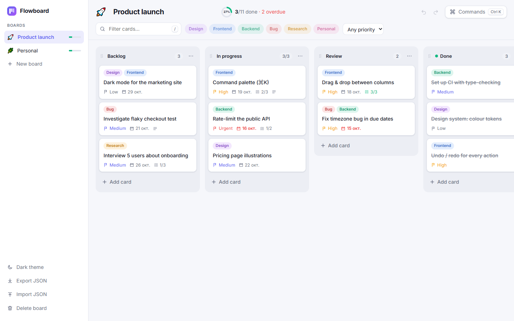
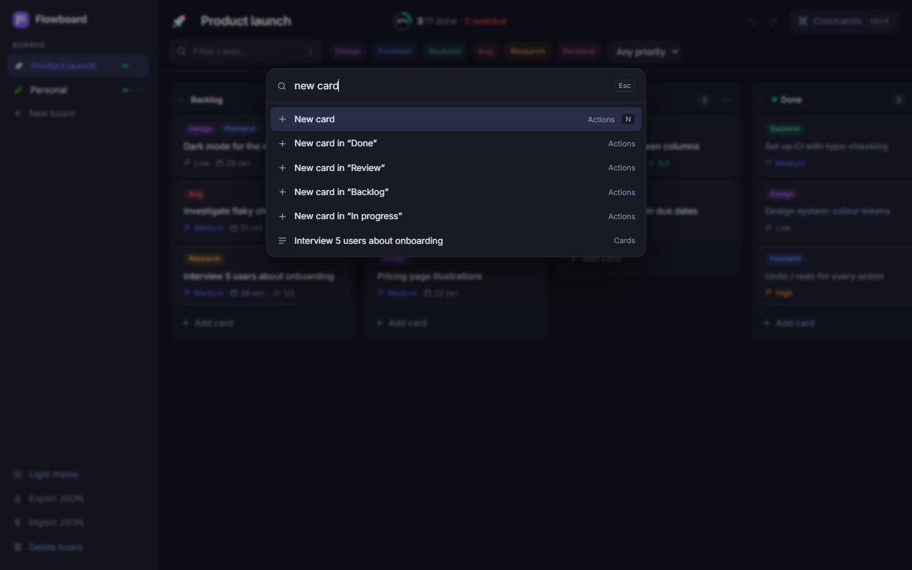

<div align="center">

# Flowboard

**A fast, keyboard-first kanban board, built with React 19, TypeScript and dnd-kit.**

[**▶ Open the live app**](https://chop-prog.github.io/flowboard/)



</div>

## Highlights

- **Drag & drop** cards between columns and reorder the columns themselves, with a mouse, touch or **the keyboard** (press `Space` on a card to pick it up, use the arrow keys to move it, then `Space` to drop).
- **Command palette** (`Ctrl/⌘ K`) with fuzzy search over actions, boards and every card.
- **Undo / redo for everything** (`Ctrl/⌘ Z`, `Ctrl/⌘ Shift Z`), including imports and board deletion.
- **Filters** by text, labels (AND) and priority, with live counts.
- **Rich cards**: labels, priority, due dates (overdue and due-today highlighting), checklists with progress, descriptions.
- **WIP limits** per column, "done" columns, and progress tracking per board.
- **Offline persistence** in `localStorage`, plus JSON export and import. Imports go through structural and referential validation, so a broken file can't crash the app.
- **Light and dark themes**, applied before first paint so there is no flash, and a responsive layout down to phones.
- **Accessible**: native `<dialog>`, a combobox and listbox palette, `aria-pressed` toggles, a radio group for priority, screen-reader announcements for drag & drop, and `prefers-reduced-motion` support.



## Architecture

```
src/
  state/
    types.ts         domain model + discriminated-union actions
    reducer.ts       pure, immutable reducer (structural sharing, no-op = same object)
    history.ts       undo/redo wrapper: past/present/future snapshots, capped at 100
    selectors.ts     filtering, board stats, fuzzy scoring
    persist.ts       localStorage + import validation
    store.tsx        React context + useReducer + debounced autosave
  components/        Sidebar, Toolbar, BoardView (DnD), Column, CardItem, CardModal, CommandPalette
  App.tsx            shortcuts, palette commands, import/export
```

Some design decisions:

- **No state library.** A single `useReducer` over a normalised state (`boards → columnIds → cardIds`) is enough. Because the reducer is pure, it is trivially testable, and undo/redo amounts to keeping references to previous states.
- **Drag & drop without history spam.** While a card is dragged, a local *preview layout* moves it between columns, so cards make room live. One `card/move` action is committed on drop, so a whole drag is a single undo step.
- **Navigation isn't an edit.** Switching boards is excluded from undo history, and undo keeps you on the board you're looking at.

## Quality

- **TypeScript strict mode**, with `noUncheckedIndexedAccess` and `verbatimModuleSyntax`.
- **29 tests** with Vitest and Testing Library: reducer, history, selectors and validation as unit tests, and full user flows (add a card → undo → redo, filtering, the card editor, the command palette) as integration tests.
- **GitHub Actions** runs the type-check, tests and build for every push, and deploys `main` to GitHub Pages.

## Keyboard shortcuts

| Keys | Action |
|---|---|
| `Ctrl/⌘ K` | Command palette |
| `N` | New card |
| `/` | Focus the filter |
| `[` / `]` | Previous / next board |
| `Ctrl/⌘ Z`, `Ctrl/⌘ Shift Z` | Undo / redo |
| `Space`, arrows | Pick up and move the focused card |
| `Enter` | Open the focused card |

## Run locally

```bash
npm install
npm run dev        # http://localhost:5173/flowboard/
npm test
npm run build
```

## License

[MIT](LICENSE)
